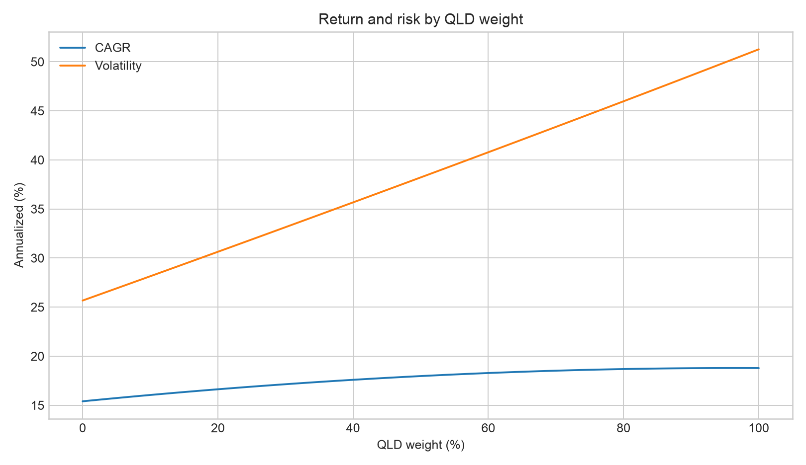
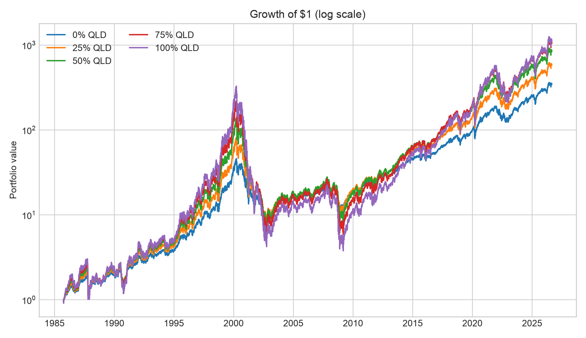
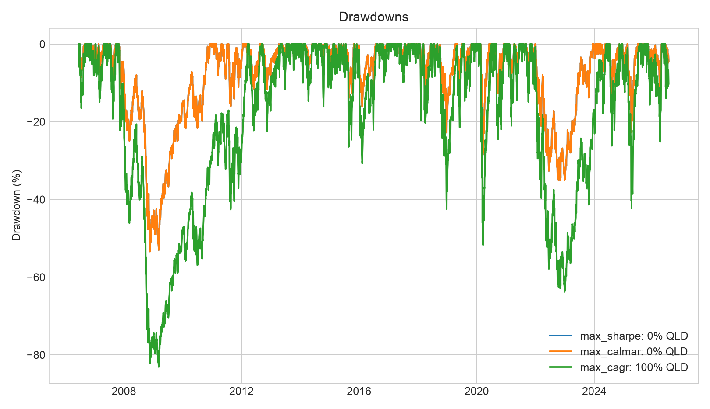
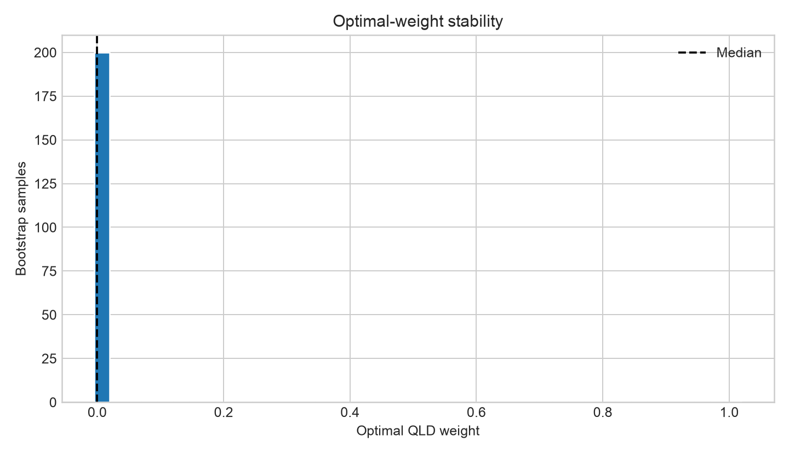

# QQQ + QLD Empirical Results

> Data window: 1985-10-02 through 2026-08-27;
> ME rebalancing; one-way turnover cost: 2.0 bps.
> Returns before 2006-06-20 are reconstructed from ^NDX and a contemporaneous short rate, so the sample spans the 1987 crash and the 2000-2002 unwind; live fund returns are used from that date on. See the reconstruction fit below.

## Bottom line

Both funds track the same index, so a QQQ/QLD blend selects a daily exposure between roughly 1x and 2x rather than adding diversification. The blend is therefore a *borrowing* decision, and it turns on two numbers: the rate QLD charges to lend, and the return assumed on what is bought with it.

Ratio objectives cannot answer it. Sharpe, Sortino and Calmar are scale-invariant in leverage -- levering one asset scales excess mean and standard deviation together -- so their argmax over a leverage grid is the lowest-leverage point by construction, whatever the data says. This report selects on expected log growth and on a CRRA certainty equivalent instead; the ratio rows are kept only for continuity.

Growth-optimal leverage is the spread between expected return and financing cost divided by variance. Financing is a large share of that spread at current rates, and the variance term is materially larger once the sample includes the 2000-2002 unwind, so both inputs move the answer more than the choice of weight granularity does.

## The optimal allocation depends on the objective

| Objective | QQQ | QLD | Target exposure (1+w)† | CAGR | Volatility | Maximum drawdown | Sharpe |
|---|---:|---:|---:|---:|---:|---:|---:|
| Maximum in-sample CAGR | 4% | 96% | 1.96x | 18.8% | 50.2% | -98.7% | 0.59 |
| Maximum log growth (full Kelly, gamma=1) | 4% | 96% | 1.96x | 18.8% | 50.2% | -98.7% | 0.59 |
| Maximum certainty equivalent (gamma=2) | 100% | 0% | 1.00x | 15.4% | 25.7% | -82.6% | 0.69 |
| Maximum in-sample Sharpe (scale-invariant: cannot select leverage) | 100% | 0% | 1.00x | 15.4% | 25.7% | -82.6% | 0.69 |
| Maximum in-sample Calmar (scale-invariant: cannot select leverage) | 21% | 79% | 1.79x | 18.7% | 45.7% | -97.6% | 0.60 |
| Closest to 25% volatility | 100% | 0% | 1.00x | 15.4% | 25.7% | -82.6% | 0.69 |
| Maximum CAGR with drawdown no worse than -60% | N/A | N/A | N/A | N/A | N/A | N/A | N/A |

The drawdown constraint of -60% is **infeasible on this sample**: the shallowest drawdown available at any weight is -82.6%, at 0% QLD. A constraint that only became satisfiable when the 2000-2002 unwind was outside the window was never a property of the strategy -- it was a property of the window. Lower the limit or accept that no admissible allocation meets it.

† Target exposure equals realized daily exposure only under daily rebalancing; see the Growth-optimal leverage section below for the actual gap at this report's ME rebalancing cadence.

## Out-of-sample performance and stability

The expanding-window walk-forward strategy produced an out-of-sample CAGR of **15.4%**, a Sharpe ratio of **0.54**, and a maximum drawdown of **-98.2%**.
For each test year the weight maximising `log_growth` is selected using only information available at the time, so no future return chooses a past weight. Read the drawdown column before the return column: a growth-optimal rule is free to select leverage that no investor would have held through.

Across the moving-block bootstrap samples, the median `log_growth`-optimal QLD weight is **94%**, with a 5th–95th percentile range of **0%–100%**. A wider interval indicates that the exact optimal percentage is less stable.

## Growth-optimal leverage (Kelly estimate)

Using this sample's annualized QQQ excess return (**17.6%**) and variance (implying **25.7%** volatility), the growth-optimal (full-Kelly) leverage on the Nasdaq-100 is **1.85x**, with a half-Kelly reference of **0.93x**. QLD is fixed at 2.00x. Clipped to the QQQ/QLD blend's achievable 1x–2x range, full-Kelly implies **85%** QLD.
This is `(mu - c) / (gamma * sigma^2)` evaluated at an estimated all-in financing cost of **5.41%**, which leaves a spread of only **12.21%** over that cost to lever. It remains a point estimate from one sample, and the trailing `mu` in it is a description of the past rather than a forecast — see the sensitivity table below and `docs/methodology.md` section 6.

### A blend is not the same as a fixed-leverage position

**70% QQQ + 30% QLD is not the same as a static 1.3x-leveraged QQQ position, for two separate reasons.** First, QLD's real daily return is only *approximately* 2x QQQ's — it embeds QLD's own expense ratio and financing spread — so even a blend rebalanced *every day* would show a gap against a *frictionless* synthetic `(1+w)`x daily-reset product, proportional to the QLD weight, that does not close no matter how often the blend rebalances. Second, and separately, this report's blend rebalances ME rather than daily, so between rebalances the two legs compound independently and realized exposure drifts further away from `1+w`. The table below quantifies the combined gap at this report's actual rebalancing cadence, comparing each weight's real backtested blend to the idealized, frictionless synthetic exposure it targets — see the frequency table further below to see the two effects separated (its `D` row isolates the first effect alone):

| Weight | Target exposure | Synthetic CAGR | Actual CAGR | CAGR gap | Return correlation |
|---|---:|---:|---:|---:|---:|
| Kelly-implied | 1.85x | 23.8% | 18.7% | -5.0% | 0.999 |
| Reference 30% QLD | 1.30x | 18.9% | 17.1% | -1.8% | 1.000 |

Holding the weight fixed at the half-Kelly allocation above (chosen because it carries a nonzero QLD weight, unlike this dataset's max-Sharpe allocation), rebalancing cadence alone changes the outcome as follows. Compare each row to the `D` (daily) row, not to zero: the gap remaining at `D` is QLD's own real cost drag, not a cadence effect, and only the *additional* gap at slower cadences reflects rebalancing frequency itself:

| rebalance   |   target_leverage |   synthetic_cagr |   actual_cagr |   cagr_gap |   synthetic_volatility |   actual_volatility |   return_correlation |
|:------------|------------------:|-----------------:|--------------:|-----------:|-----------------------:|--------------------:|---------------------:|
| D           |            1.3000 |           0.1893 |        0.1721 |    -0.0172 |                 0.3337 |              0.3334 |               0.9997 |
| W           |            1.3000 |           0.1893 |        0.1712 |    -0.0181 |                 0.3337 |              0.3327 |               0.9997 |
| ME          |            1.3000 |           0.1893 |        0.1714 |    -0.0179 |                 0.3337 |              0.3315 |               0.9996 |
| QE          |            1.3000 |           0.1893 |        0.1738 |    -0.0155 |                 0.3337 |              0.3303 |               0.9994 |

### Sensitivity to the assumed forward return (μ)

Growth-optimal leverage is `(mu - c) / (gamma * sigma^2)`, so it is driven by the *spread* of expected return over the financing cost `c`, not by the expected return itself. At the estimated all-in rate that spread is a difference between two similar-sized numbers, which is why the recommendation swings so far across assumptions that all look reasonable. Assumed returns below are **geometric**, the convention capital-market assumptions publish; the arithmetic column adds `0.5*sigma^2` = 3.3%, which Kelly is defined on. This sample's volatility (**25.7%**) is held fixed across rows because it is far better estimated than mu (see `docs/methodology.md` section 6.2); scenarios are editable in `config/default.yaml`:

| Scenario | Assumed μ (geometric) | μ (arithmetic) | Spread over financing | Full Kelly | γ=2 | γ=2 QLD weight |
|---|---:|---:|---:|---:|---:|---:|
| Trailing sample (this backtest) | 15.4% | 18.7% | 13.3% | 2.02x | 1.01x | 1% |
| Optimistic (AI upside beyond consensus) | 12.0% | 15.3% | 9.9% | 1.50x | 0.75x | 0% |
| Neutral (historical equity premium) | 9.0% | 12.3% | 6.9% | 1.04x | 0.52x | 0% |
| Conservative (valuation-anchored ~10y CMA) | 6.0% | 9.3% | 3.9% | 0.59x | 0.29x | 0% |
| Bear (multiple reversion) | 3.0% | 6.3% | 0.9% | 0.13x | 0.07x | 0% |

This is not a forecast produced by this tool -- the non-trailing rows are assumptions you (or the config file) supplied. The point is the spread: a plausible range of forward μ assumptions maps to a very different recommended weight, from heavily levered to unlevered.

## Interpretation limits

The practical appeal of QQQ plus QLD is that two liquid ETFs can continuously adjust target daily Nasdaq-100 exposure from approximately 1x to 2x.
However, the funds track the same index and do not diversify across asset classes. QLD resets daily, so long-horizon results depend on path, volatility, financing, fees, and tracking error.
The table reports estimates for this historical window and these assumptions. It is not a forecast, a guarantee, or personalized investment advice.

## Recommended leverage: **1.23x** (23% QLD)

Three estimators of the same quantity, in increasing order of realism. They agree, which is the check that the headline is not an artefact of the lognormal assumption:

| Estimator | What it adds | Leverage |
|---|---|---:|
| Closed form `(mu-c)/(gamma*sigma^2)` | lognormal returns | 1.31x |
| **Realised path** (headline) | real fat tails (excess kurtosis ~8), path dependence; deterministic | **1.23x** |
| 30-year block bootstrap | finite horizon, median terminal wealth | 1.20-1.27x |

The bootstrap is the most realistic estimator and the least precise: its argmax moves by about 0.02 between resampling seeds, so it is quoted as an interval rather than a number. The headline comes from the full realised sequence, which resamples nothing and so has no sampling noise -- that is what makes two decimals meaningful here. The closed form sits above both because its lognormal assumption understates what fat tails cost a levered position.

`L* = (mu - c) / (gamma * sigma^2)` at a forward geometric return of **9.50%** (arithmetic 12.26%), an all-in financing cost of **5.01%**, volatility of **23.50%**, and CRRA risk aversion **1**. The spread available to lever is 7.25%.

This is an interior optimum: the assumptions genuinely select this exposure rather than being clipped to the edge of what a long-only blend can reach.

Kelly's optimality is a theorem about which strategy wins, not a risk preference, so `gamma = 1` is the right setting for a purely wealth-maximising objective. Note that true risk *neutrality* is `gamma = 0`, which prescribes unbounded leverage and certain ruin -- so "only cares about money" cannot mean maximising expected wealth; it has to mean maximising its growth rate. Estimation error in `mu` is *not* a further reason to raise gamma: expected log growth is linear in mu, so uncertainty leaves the optimum at `E[mu]`. Being wrong about `E[mu]` is what moves the answer.

Two of those four inputs are measured and two are asserted. `sigma^2` comes from the reconstructed 1985-2026 history and `c` from the funds' own returns; the forward return and the risk aversion are a view and a preference respectively, set in `config/default.yaml` under `recommendation`. Changing them changes this number, which is why the table below matters more than the number does.

### What each leverage level requires you to believe

Inverting the formula is the more useful direction: rather than arguing about the assumed return, each row states the forward geometric return that would make that leverage optimal. Compare them against the 15.4% this sample actually realised over forty years -- and against the fact that it realised it in the best-performing major index, chosen in hindsight.

|       | QLD weight   | Required forward return (γ=1)   | Required forward return (γ=1.5)   | Required forward return (γ=2)   |
|:------|:-------------|:--------------------------------|:----------------------------------|:--------------------------------|
| 1.00x | 0%           | 7.77%                           | 10.54%                            | 13.30%                          |
| 1.15x | 15%          | 8.60%                           | 11.78%                            | 14.95%                          |
| 1.30x | 30%          | 9.43%                           | 13.02%                            | 16.61%                          |
| 1.50x | 50%          | 10.54%                          | 14.68%                            | 18.82%                          |
| 2.00x | 100%         | 13.30%                          | 18.82%                            | 24.34%                          |

### Terminal wealth over 30 years

Block-bootstrapped holding periods, so volatility clustering survives resampling. Read the median column, not the mean: mean terminal wealth rises with leverage without limit because a thin right tail carries it, which is precisely the statistic that makes leverage look better than it is. `prob_beats_unlevered` compares against 1x on the *same* draw.

|       |   median_multiple |   mean_multiple |   p5_multiple |   p95_multiple |   prob_beats_unlevered |
|:------|------------------:|----------------:|--------------:|---------------:|-----------------------:|
| 1.00x |             15.65 |           31.16 |          1.81 |         107.43 |                   0.00 |
| 1.15x |             16.39 |           40.91 |          1.36 |         153.01 |                   0.58 |
| 1.30x |             16.45 |           53.42 |          0.99 |         210.24 |                   0.55 |
| 1.50x |             15.48 |           75.51 |          0.61 |         304.09 |                   0.50 |
| 2.00x |             10.34 |          168.39 |          0.12 |         573.39 |                   0.37 |

Note the shape near the optimum: the median is nearly flat while the 5th percentile deteriorates quickly. That asymmetry is a reason to err below a leverage estimate rather than above it, and it follows from the curvature of the growth function rather than from any attitude to risk.

## What QLD charges to lend

QLD's daily objective is exactly 2x the index, so the shortfall of its realised return against twice QQQ's identifies its embedded cost. Netting out QQQ's own expense ratio (which QLD does not pay) and a contemporaneous 3-month bill leaves the spread its swap counterparties charged. The fee premium below is a closed form, `ER_QLD - 2*ER_QQQ`, and is invariant to the blend weight: it is the extra cost per dollar borrowed of borrowing through the blend rather than on margin.

| Component | Rate |
|---|---:|
| Estimated swap spread over bills | 1.16% |
| Current benchmark (3-month bill) | 3.70% |
| Fund fee premium (`ER_QLD - 2*ER_QQQ`) | 0.55% |
| **All-in effective borrowing rate** | **5.41%** |

Compare that last figure directly against a broker's quoted margin rate: below it, margin is the cheaper way to reach the same exposure; above it, the blend is, and the blend additionally cannot be margin-called.

The spread is not constant -- it reflects funding conditions at the time, and widens under stress:

| period_end   | start      | end        |   alpha |   mean_risk_free |   implied_financing_rate |   implied_spread |   years |
|:-------------|:-----------|:-----------|--------:|-----------------:|-------------------------:|-----------------:|--------:|
| 2011-12-31   | 2007-01-03 | 2011-12-30 | -0.0350 |           0.0121 |                   0.0295 |           0.0174 |  5.0000 |
| 2016-12-31   | 2012-01-03 | 2016-12-30 | -0.0122 |           0.0011 |                   0.0067 |           0.0057 |  4.9921 |
| 2021-12-31   | 2017-01-03 | 2021-12-31 | -0.0256 |           0.0106 |                   0.0201 |           0.0094 |  4.9960 |
| 2026-12-31   | 2022-01-03 | 2026-08-27 | -0.0592 |           0.0398 |                   0.0537 |           0.0139 |  4.6310 |

## Drawdown by episode and weight

The binding constraint on a leveraged position is not its average outcome but whether the worst realised path would have ended it. Recovering from a drawdown of `d` requires a gain of `d/(1-d)`, so these differences are not linear in pain.

| episode           |   qld_0% |   qld_15% |   qld_30% |   qld_50% |   qld_100% |
|:------------------|---------:|----------:|----------:|----------:|-----------:|
| 1987 crash        |   -0.399 |    -0.441 |    -0.482 |    -0.536 |     -0.667 |
| Dot-com 2000-2002 |   -0.826 |    -0.878 |    -0.915 |    -0.949 |     -0.987 |
| GFC 2007-2009     |   -0.534 |    -0.592 |    -0.648 |    -0.712 |     -0.831 |
| COVID 2020        |   -0.286 |    -0.323 |    -0.360 |    -0.406 |     -0.517 |
| 2022 rate shock   |   -0.348 |    -0.398 |    -0.446 |    -0.505 |     -0.632 |
| Full sample       |   -0.826 |    -0.878 |    -0.915 |    -0.949 |     -0.988 |

## Reconstruction fit over the live overlap

Pre-2006 returns are simulated from the Nasdaq-100 and a contemporaneous short rate. Mean returns match by construction because the two free parameters are calibrated on this overlap; the informative columns are the correlation and tracking error, which say whether the reconstruction follows the same path, and the drawdown comparison, which is what the stress table depends on.

| series   |   real_cagr |   synthetic_cagr |   correlation |   tracking_error |   real_max_drawdown |   synthetic_max_drawdown |
|:---------|------------:|-----------------:|--------------:|-----------------:|--------------------:|-------------------------:|
| QQQ      |      0.1663 |           0.1652 |        0.9966 |           0.0189 |             -0.5340 |                  -0.5339 |
| QLD      |      0.2534 |           0.2476 |        0.9957 |           0.0427 |             -0.8313 |                  -0.8297 |

## Charts

## Walk-forward annual selections

| test_start   | test_end   |   selected_weight_qld |    cagr |   volatility |   sharpe |   sortino |   max_drawdown |   calmar |   terminal_multiple |   log_growth |
|:-------------|:-----------|----------------------:|--------:|-------------:|---------:|----------:|---------------:|---------:|--------------------:|-------------:|
| 1990-01-02   | 1990-12-31 |                0.9500 | -0.2817 |       0.4218 |  -0.5731 |   -0.8979 |        -0.5587 |  -0.5043 |              0.7173 |      -0.3309 |
| 1991-01-02   | 1991-12-31 |                0.3200 |  0.8904 |       0.2750 |   2.4557 |    5.1157 |        -0.1518 |   5.8647 |              1.8952 |       0.6368 |
| 1992-01-02   | 1992-12-31 |                1.0000 |  0.0957 |       0.3948 |   0.4273 |    0.3595 |        -0.3664 |   0.2611 |              1.0964 |       0.0914 |
| 1993-01-04   | 1993-12-31 |                1.0000 |  0.1466 |       0.3417 |   0.5711 |    0.6133 |        -0.2778 |   0.5276 |              1.1472 |       0.1368 |
| 1994-01-03   | 1994-12-30 |                1.0000 | -0.0436 |       0.3324 |   0.0317 |   -0.1855 |        -0.3094 |  -0.1408 |              0.9564 |      -0.0445 |
| 1995-01-03   | 1995-12-29 |                0.9700 |  0.8098 |       0.4377 |   1.5754 |    2.7412 |        -0.2324 |   3.4854 |              1.8098 |       0.5932 |
| 1996-01-02   | 1996-12-31 |                1.0000 |  0.8182 |       0.4501 |   1.5552 |    2.6723 |        -0.2806 |   2.9155 |              1.8269 |       0.5978 |
| 1997-01-02   | 1997-12-31 |                1.0000 |  0.2781 |       0.5419 |   0.7235 |    0.7512 |        -0.3613 |   0.7698 |              1.2794 |       0.2454 |
| 1998-01-02   | 1998-12-31 |                1.0000 |  1.9311 |       0.6451 |   1.9952 |    4.4404 |        -0.4419 |   4.3696 |              2.9311 |       1.0754 |
| 1999-01-04   | 1999-12-31 |                1.0000 |  2.4661 |       0.6669 |   2.2007 |    5.6903 |        -0.2344 |  10.5212 |              3.4661 |       1.2430 |
| 2000-01-03   | 2000-12-29 |                1.0000 | -0.7282 |       1.1364 |  -0.5817 |   -0.9218 |        -0.8369 |  -0.8701 |              0.2718 |      -1.3026 |
| 2001-01-02   | 2001-12-31 |                1.0000 | -0.6835 |       1.1224 |  -0.4729 |   -0.8827 |        -0.8644 |  -0.7908 |              0.3223 |      -1.1505 |
| 2002-01-02   | 2002-12-31 |                0.6500 | -0.5900 |       0.7086 |  -0.9068 |   -1.1995 |        -0.7276 |  -0.8109 |              0.4100 |      -0.8916 |
| 2003-01-02   | 2003-12-31 |                0.2000 |  0.5998 |       0.3086 |   1.6774 |    3.0508 |        -0.1562 |   3.8398 |              1.5998 |       0.4699 |
| 2004-01-02   | 2004-12-31 |                0.4000 |  0.1320 |       0.2575 |   0.6099 |    0.7383 |        -0.2241 |   0.5891 |              1.1320 |       0.1240 |
| 2005-01-03   | 2005-12-30 |                0.4300 |  0.0052 |       0.1984 |   0.1248 |    0.0370 |        -0.1744 |   0.0297 |              1.0052 |       0.0052 |
| 2006-01-03   | 2006-12-29 |                0.4000 |  0.0687 |       0.2177 |   0.4134 |    0.4576 |        -0.2444 |   0.2809 |              1.0684 |       0.0664 |
| 2007-01-03   | 2007-12-31 |                0.3900 |  0.2315 |       0.2499 |   0.9586 |    1.2920 |        -0.1566 |   1.4779 |              1.2305 |       0.2082 |
| 2008-01-02   | 2008-12-31 |                0.4400 | -0.5738 |       0.5608 |  -1.2397 |   -1.4034 |        -0.6445 |  -0.8904 |              0.4247 |      -0.8529 |
| 2009-01-02   | 2009-12-31 |                0.0200 |  0.5585 |       0.2604 |   1.8348 |    3.3041 |        -0.1863 |   2.9972 |              1.5585 |       0.4437 |
| 2010-01-04   | 2010-12-31 |                0.2300 |  0.2434 |       0.2357 |   1.0423 |    1.4841 |        -0.1916 |   1.2706 |              1.2434 |       0.2178 |
| 2011-01-03   | 2011-12-30 |                0.3100 |  0.0268 |       0.3072 |   0.2399 |    0.1206 |        -0.2073 |   0.1294 |              1.0268 |       0.0265 |
| 2012-01-03   | 2012-12-31 |                0.2900 |  0.2325 |       0.1969 |   1.1602 |    1.8025 |        -0.1485 |   1.5654 |              1.2305 |       0.2091 |
| 2013-01-02   | 2013-12-31 |                0.3600 |  0.5178 |       0.1661 |   2.5973 |    4.7864 |        -0.0795 |   6.5158 |              1.5178 |       0.4172 |
| 2014-01-02   | 2014-12-31 |                0.5100 |  0.2843 |       0.2085 |   1.3049 |    1.9291 |        -0.1230 |   2.3115 |              1.2843 |       0.2502 |
| 2015-01-02   | 2015-12-31 |                0.5800 |  0.1296 |       0.2794 |   0.5756 |    0.6631 |        -0.2128 |   0.6090 |              1.1296 |       0.1218 |
| 2016-01-04   | 2016-12-30 |                0.6000 |  0.0923 |       0.2567 |   0.4726 |    0.4947 |        -0.1900 |   0.4859 |              1.0923 |       0.0883 |
| 2017-01-03   | 2017-12-29 |                0.6100 |  0.5499 |       0.1649 |   2.7427 |    4.9164 |        -0.0797 |   6.9044 |              1.5472 |       0.4382 |
| 2018-01-02   | 2018-12-31 |                0.7300 | -0.0579 |       0.3908 |   0.0432 |   -0.1999 |        -0.3744 |  -0.1546 |              0.9424 |      -0.0596 |
| 2019-01-02   | 2019-12-31 |                0.6800 |  0.6725 |       0.2728 |   2.0233 |    3.6004 |        -0.1799 |   3.7373 |              1.6725 |       0.5143 |
| 2020-01-02   | 2020-12-31 |                0.8000 |  0.8072 |       0.6400 |   1.2513 |    1.7567 |        -0.4740 |   1.7031 |              1.8115 |       0.5918 |
| 2021-01-04   | 2021-12-31 |                0.8900 |  0.5157 |       0.3443 |   1.3808 |    2.1722 |        -0.1996 |   2.5842 |              1.5157 |       0.4159 |
| 2022-01-03   | 2022-12-30 |                0.9600 | -0.5987 |       0.6320 |  -1.1265 |   -1.2844 |        -0.6228 |  -0.9613 |              0.4028 |      -0.9130 |
| 2023-01-03   | 2023-12-29 |                0.7400 |  1.0050 |       0.3124 |   2.3849 |    5.2115 |        -0.1964 |   5.1164 |              1.9940 |       0.6957 |
| 2024-01-02   | 2024-12-31 |                0.8700 |  0.4021 |       0.3372 |   1.1717 |    1.6892 |        -0.2464 |   1.6317 |              1.4021 |       0.3379 |
| 2025-01-02   | 2025-12-31 |                0.9100 |  0.2961 |       0.4457 |   0.8002 |    0.9899 |        -0.4023 |   0.7361 |              1.2935 |       0.2594 |
| 2026-01-02   | 2026-08-27 |                0.9400 |  0.4826 |       0.4110 |   1.1633 |    1.7555 |        -0.2247 |   2.1482 |              1.2921 |       0.3938 |
